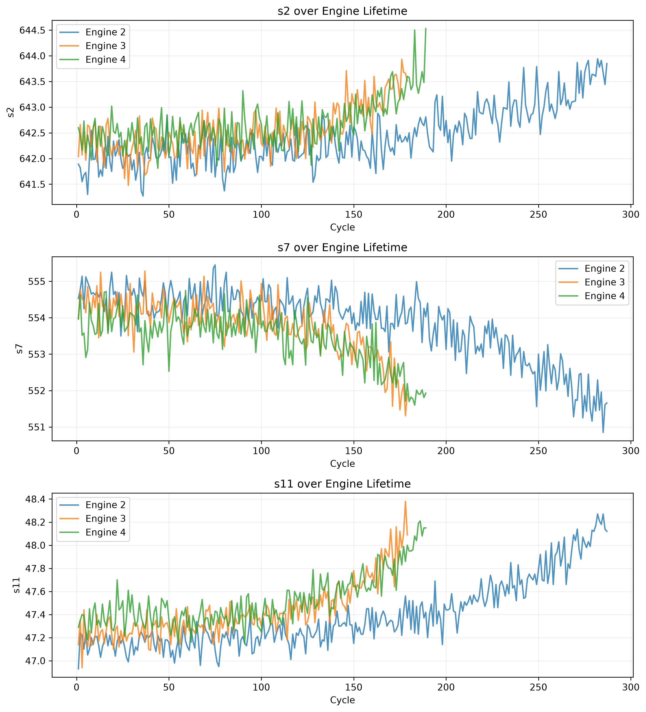
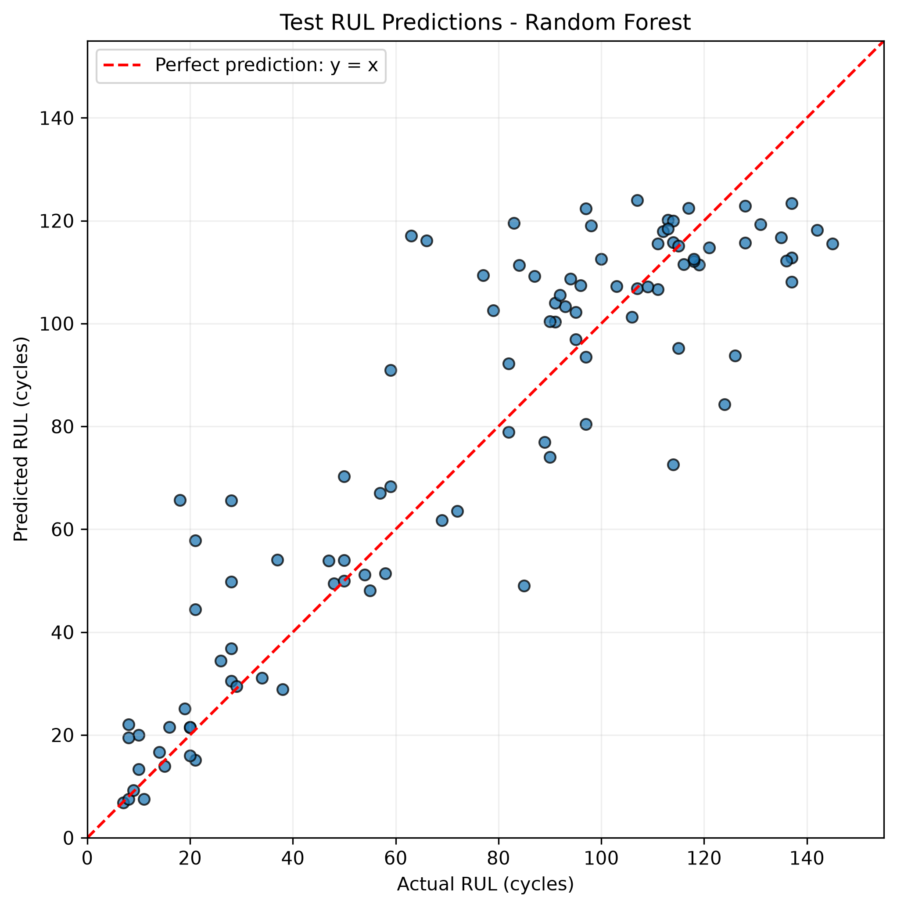
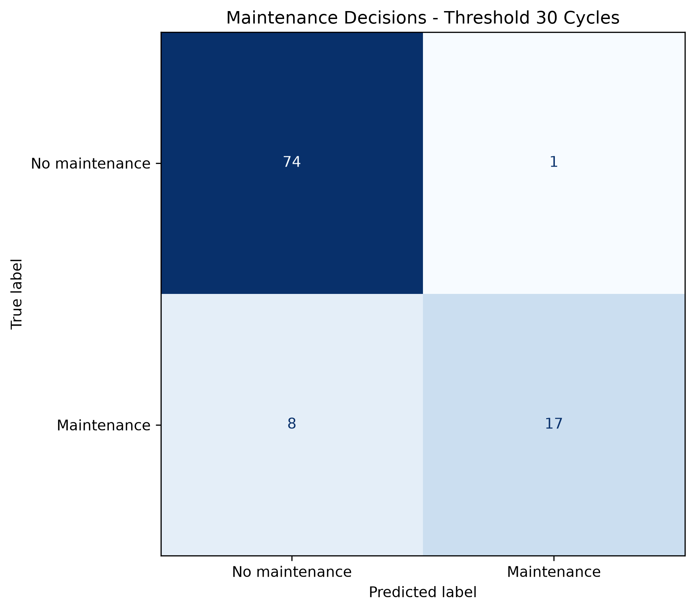

# Turbofan Remaining Useful Life Prediction

**Key results (FD001 test set):** Random Forest, RMSE 18.1 cycles, MAE 13.2 cycles.
With a 30-cycle alert threshold, 17 of 25 engines needing maintenance were flagged,
8 were missed and 1 alert was premature.

## Goal

Predict the remaining useful life (RUL) of simulated turbofan engines using sensor measurements, and translate predictions into maintenance alerts.

## Data

NASA C-MAPSS, subset FD001: one operating condition and one fault mode.

- Training: 100 engines observed until failure.
- Test: 100 separate engines with truncated histories.
- RUL file: remaining cycles at each test engine's last recorded cycle.

Download and dataset information:
[Direct download (ZIP)](https://phm-datasets.s3.amazonaws.com/NASA/6.+Turbofan+Engine+Degradation+Simulation+Data+Set.zip) | [NASA dataset repository](https://www.nasa.gov/intelligent-systems-division/discovery-and-systems-health/pcoe/pcoe-data-set-repository/)

Citation: A. Saxena and K. Goebel (2008).
"Turbofan Engine Degradation Simulation Data Set",
NASA Prognostics Data Repository, NASA Ames Research Center.

Place train_FD001.txt, test_FD001.txt and RUL_FD001.txt in data/.
The dataset is excluded from Git.

## Method

1. Read whitespace-separated files and validate their structure.
2. Calculate engine lifetimes and inspect sensor trends.
3. Create raw RUL as maximum engine cycle minus current cycle.
4. Cap training RUL at 125 cycles. Early-life degradation is
   difficult to distinguish in the sensor measurements, so this
   target represents an assumed healthy-life plateau.
5. Split training engines into 80% training and 20% validation using
   GroupShuffleSplit with random_state=42.
6. Remove measurements with training-partition standard deviation
   below 0.01. This threshold is specific to the original
   FD001 measurement units and is not a universal selection rule.
7. Train Linear Regression and Random Forest models.
8. Select the model using validation RMSE.
9. Refit both models on all training engines with the fixed feature list.
10. Evaluate one last-cycle observation per test engine.

Removed features: setting1, setting2, setting3, s1, s5, s6, s10, s16, s18, s19.

Engine ID, cycle, raw RUL and target RUL are excluded from model inputs.

Sensor and correlation plots use the training partition.
No features are selected using test performance.

## Results

Training engine lifetime:
- Mean: 206.31 cycles.
- Minimum: 128 cycles.
- Maximum: 362 cycles.

### Validation

Metrics use capped RUL across all rows of the 20 validation engines.

| Model | RMSE (cycles) | MAE (cycles) |
|---|---:|---:|
| Linear Regression | 20.428 | 16.510 |
| Random Forest | 16.996 | 12.286 |

Selected model: **Random Forest**.

### Test

Metrics use original, uncapped RUL at the last recorded cycle
of each test engine.

| Model | RMSE (cycles) | MAE (cycles) |
|---|---:|---:|
| Linear Regression | 21.900 | 17.606 |
| Random Forest | 18.116 | 13.212 |

Validation and test scores use different target and sampling
conventions and should not be compared directly.

The capped training target can cause underprediction for engines
whose true test RUL exceeds 125 cycles.







Random Forest assigns 61.2% of impurity-based feature importance to s11 and ranks s9 second (13.2%); s9 has a moderate negative linear correlation with capped RUL (Pearson r = -0.460), Random Forest can capture nonlinear relationships, and s9 and s14 are strongly correlated (r = 0.965), so importance should not be interpreted as a unique or causal contribution.

Additional plots:
- images/engine_lifetime_histogram.png
- images/correlation_matrix.png
- images/feature_importance.png

Sensor observations:

- s2 generally increases near failure in the three inspected engines.
- s7 generally decreases near failure in the three inspected engines.
- s11 generally increases near failure in the three inspected engines.

## Maintenance Interpretation

An alert is issued when predicted RUL is at most
30 cycles. Actual maintenance need is defined
using the same threshold on true RUL.

- Correct alerts: 17.
- False alerts: 1.
- Missed maintenance needs: 8.
- Correct no-alert decisions: 74.

From a maintenance manager's perspective, missed maintenance needs
are usually more costly because they can lead to unplanned downtime
and equipment damage. False alerts lead to premature maintenance
and additional costs. Raising the alert threshold generally reduces
missed needs but increases early alerts; lowering it has the opposite
effect. An alternative alert threshold should be chosen using
validation scenarios and operational costs, while keeping the true
need definition fixed at 30 cycles. Test results should be reserved
for final reporting. A missed need here is a missed threshold-based
maintenance decision, not an observed real-world failure.

### Missed maintenance needs

| unit | last_cycle | actual_RUL | predicted_RUL |
|---:|---:|---:|---:|
| 18 | 133 | 28 | 65.594 |
| 37 | 121 | 21 | 57.850 |
| 40 | 133 | 28 | 30.493 |
| 41 | 123 | 18 | 65.640 |
| 53 | 164 | 26 | 34.426 |
| 61 | 159 | 21 | 44.409 |
| 64 | 168 | 28 | 49.755 |
| 90 | 146 | 28 | 36.805 |

The eight missed engines do not have shorter recorded histories on average: their mean last_cycle is 143.4 (median 139.5), compared with 129.9 (median 133.5) for the other 92 test engines. This descriptive comparison does not support shorter histories as the explanation for these missed alerts and does not establish the cause of the errors. The model uses sensor measurements from only the last recorded cycle of each test engine and does not see sensor trends or earlier-cycle history.

The missed engines tend to be short-lived: their total lifetime
(last_cycle + actual_RUL) has a median of 167.5 cycles (range 141–196),
compared with 204 cycles for the 17 correctly alerted engines. This is
consistent with a single-cycle model underestimating fast degradation,
which motivates trend-based features as a next step.

## Next Steps

- Evaluate several grouped validation splits.
- Evaluate simulated truncated histories on validation engines.
- Add causal rolling sensor averages and trends.
- Tune Random Forest parameters using validation data.
- Compare capped and uncapped target strategies.
- Assess maintenance thresholds using explicit error costs.
- Validate on other C-MAPSS subsets.

## Run

```bash
python -m pip install -r requirements.txt
python src/main.py
```

Outputs are saved in images/ and results/.
